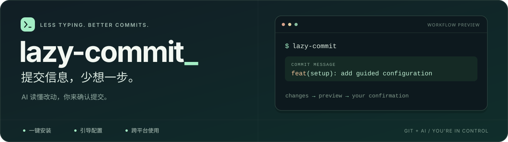
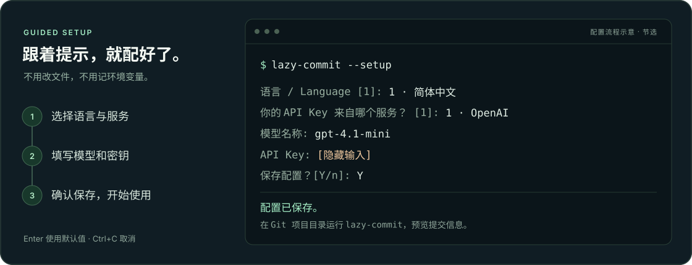

<p align="center">
  
</p>

<p align="center">
  <a href="https://github.com/Kingsmai/lazy-commit/actions/workflows/ci.yml"></a>
  <a href="docs/REFERENCE.md#platform-support"></a>
  <a href="LICENSE"></a>
</p>

<p align="center">
  <b>一条命令安装，跟着向导配置，在提交前由你确认。</b><br />
  <a href="#开始使用">开始使用</a> · <a href="docs/REFERENCE.md">完整文档</a> · <a href="CONTRIBUTING.md">参与开发</a>
</p>

## 开始使用

准备好 **Git** 和模型服务的 **API Key**，复制命令即可。无需预装 Python。

**macOS / Linux / WSL**

```sh
curl -fsSL https://raw.githubusercontent.com/Kingsmai/lazy-commit/main/scripts/install.sh | sh
```

**Windows PowerShell**

```powershell
powershell -NoProfile -ExecutionPolicy Bypass -Command "irm https://raw.githubusercontent.com/Kingsmai/lazy-commit/main/scripts/install.ps1 | iex"
```

安装后自动进入向导：**选语言 → 选服务 → 填模型与密钥 → 保存**。完成后重开终端。

<details>
<summary>看看配置过程</summary>



按回车使用默认值，按 `Ctrl+C` 取消。向导未打开时，运行 `lazy-commit --setup`。

</details>

> 密钥隐藏输入，以明文保存在用户目录，不写入项目。向导不调用模型；已有环境变量优先于保存的配置。

## 写代码，然后交给它

在 Git 项目目录运行，**先预览**提交信息：

```sh
lazy-commit
```

想暂存所有改动并提交？检查生成的信息，再确认：

```sh
lazy-commit --apply --stage-all
```

| 想做什么 | 运行什么 |
| :--- | :--- |
| 修改模型、密钥或语言 | `lazy-commit --setup` |
| 打开全屏交互界面 | `lazy-commit --tui` |
| 更新 / 卸载 | 重跑安装命令 / `uv tool uninstall lazy-commit` |

<sub>找不到命令？重开终端。API 报错？运行 <code>lazy-commit --setup</code> 核对配置。更多见 <a href="docs/REFERENCE.md#troubleshooting">常见问题</a>。</sub>
